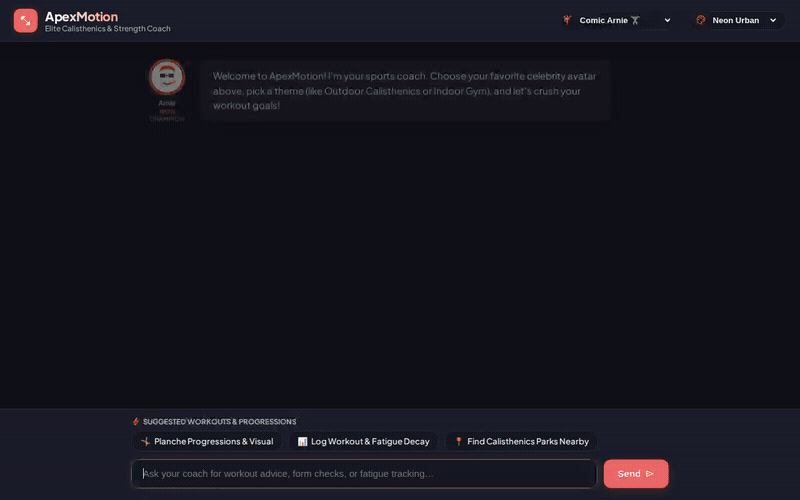

# ApexMotion — Calisthenics & Sport Strength Coach Agent



**ApexMotion** is an intelligent calisthenics and athletic strength coach agent built on the **Google Agent Development Kit (ADK)** and deployed to **Agent Platform (Agent Engine)** on Google Cloud. It provides personalized skill progressions (planche, front lever, muscle-ups), logs multi-set workouts with muscle-specific exhaustion tracking, dynamically simulates recovery decay, and generates visual cues.

---

## What ApexMotion Actually Does

Based directly on the code implemented in [`app/`](app/):

1. **Long-Term Memory (`Vertex AI Memory Bank`)**
   - Uses `PreloadMemoryTool` to inject recalled athlete facts into context at session start.
   - Runs an `after_agent_callback` (`generate_memories_callback`) to automatically extract and persist athlete goals, favorable workouts, skill targets, food/nutrition preferences, and muscle fatigue history across conversations.

2. **Muscle Fatigue & Workout Database (`Cloud Firestore`)**
   - **`list_exercises` / `get_exercise_details`**: Queries curated calisthenics progressions, target muscle groups, and technical execution cues stored in Firestore.
   - **`log_workout_session`**: Records multi-set exercises with volume and RPE (Rating of Perceived Exertion, 1–10). Computes acute muscle strain and updates current exhaustion scores for targeted muscle groups (`chest`, `anterior_delts`, `lats`, `biceps`, `triceps`, `core`, `quads`, etc.).
   - **`get_muscle_exhaustion`**: Fetches the athlete's real-time muscle fatigue profile and readiness state.

3. **Mathematical Recovery Decay & Sandboxed Execution (`Agent Engine Sandbox`)**
   - **`compute_recovery_decay`**: Computes exponential muscle recovery decay over time using muscle-specific biological half-lives:
     $$\text{Fatigue}(t) = \text{Initial Fatigue} \times e^{-\frac{\ln(2) \cdot \Delta t}{t_{1/2}}}$$
   - Runs code safely in an isolated **`AgentEngineSandboxCodeExecutor`** remote sandbox environment.

4. **Calisthenics Visual Generation & Storage (`Cloud Storage` + Imagen / Gemini)**
   - **`generate_exercise_image`**: Generates anatomical illustrations and exercise alignment visuals using `gemini-3.1-flash-lite-image` in the `global` region. Saves the file as a session artifact via `tool_context.save_artifact` and uploads raw image bytes to a public Google Cloud Storage bucket.
   - **`generate_exercise_video`**: Generates short skill demonstration videos using Google's Omni model (`gemini-omni-flash-preview`) in the `global` region. Saves the video as a session artifact and uploads raw bytes directly to Cloud Storage.
   - **`generate_and_store_form_visual`**: Generates technical SVG alignment and posture cue diagrams and publishes them directly to Cloud Storage.

5. **Nearby Facilities & Geocoding (`Google Maps API`)**
   - **`geocode_address`**: Converts street addresses or city names into latitude/longitude coordinates via the Google Maps Geocoding REST API.
   - **`search_nearby_places`**: Discovers athletic gyms, outdoor calisthenics parks, and gymnastics facilities near coordinates using the Google Maps Places (New) REST API.

6. **External Exercise Database Integration (`wger REST API`)**
   - **`search_public_exercises`**: Searches the free, public open-source wger database for general strength, barbell, and gym exercise alternatives.

7. **Email Workout Routine Delivery (`SendGrid API`)**
   - **`send_workout_email`**: Dispatches formatted HTML training plans and session routines directly to an athlete's email address.

8. **Rich Agent-to-Agent UI (`A2UI v0.8`)**
   - Emits structured A2UI component trees (`Card`, `Column`, `Row`, `Text`, `Image`) using `A2uiSchemaManager` (version 0.8) and the Basic Catalog.
   - Uses an `after_model_callback` (`a2ui_callback`) to transform card responses into clean A2A data parts.

9. **Themed Comic Dialogue Frontend (`FastAPI` + `A2A SDK`)**
   - Features a custom comic-book dialogue interface with cute celebrity athlete avatars (Comic Arnie, Master Lee, Champion Serena, Sensei Goku).
   - Includes dynamic theme switching (Indoor Gym, Outdoor Calisthenics Park, Urban Neon, Electric Cyber) and clickable quick-start prompt chips.

---

## Cloud Services & Infrastructure Wired Up

| Service | Role in ApexMotion |
|---|---|
| **Vertex AI Reasoning Engine** | Hosts the deployed agent runtime and Memory Bank instance. |
| **Agent Engine Code Sandbox** | Runs recovery simulation algorithms in an isolated remote environment. |
| **Google Cloud Firestore** | Stores exercise catalog data, athlete profiles, and workout history. |
| **Google Cloud Storage** | Hosts public image and video demonstration assets. |
| **Vertex AI Gemini Models** | `gemini-3.6-flash` (agent reasoning), `gemini-3.1-flash-lite-image` (images), and `gemini-omni-flash-preview` (video). |
| **Cloud Run** | Hosts the production FastAPI proxy and chat web frontend. |
| **Google Maps Platform** | Geocoding and Places (New) APIs for finding training parks and gyms. |

*(Note: Real-time sensor wearables ingestion was discussed in early planning and is **planned, not yet implemented**).*

---

## Local Setup & Run Instructions

### Prerequisites
- Python 3.11+
- `uv` package manager (`curl -LsSf https://astral.sh/uv/install.sh | sh`)
- Google Cloud CLI (`gcloud`) authenticated to your Google Cloud project

### 1. Environment Configuration
Create a `.env` file in the project root:
```bash
GOOGLE_GENAI_USE_VERTEXAI=true
GOOGLE_CLOUD_PROJECT="<your-gcp-project-id>"
GOOGLE_CLOUD_LOCATION="us-east1"
GOOGLE_MAPS_API_KEY="<your-google-maps-api-key>"
SENDGRID_API_KEY="<your-sendgrid-api-key-optional>"
```

### 2. Install Dependencies
```bash
# In the project root:
uv sync
```

### 3. Run the ADK Local Playground
Launch the ADK web interface connected to your Memory Bank:
```bash
uv run adk web . --port 8080 --reload_agents --memory_service_uri=agentengine://<YOUR_AGENT_ENGINE_ID>
```

### 4. Run the Custom Frontend (Optional)
To run the custom comic-themed chat UI locally:
```bash
cd frontend
python3 -m venv .venv
source .venv/bin/activate
pip install -r requirements.txt

export AGENT_ENGINE_RESOURCE_NAME="projects/<PROJECT_NUMBER>/locations/us-east1/reasoningEngines/<REASONING_ENGINE_ID>"
export AGENT_DIRECTORY="app"
export PORT=8080

python main.py
```
